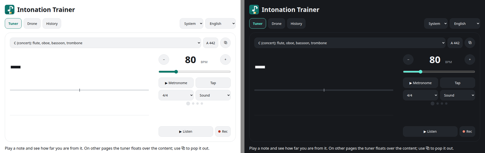

# Intonation Trainer

[](https://github.com/inkstaveapp/intonation-trainer/actions/workflows/pages.yml)
[](LICENSE)

Practise your intonation with live feedback. Play a note and see how many cents sharp or flat you are, score your playing, and keep a log of your sessions. It runs in the browser, works offline, and never records or uploads your audio.



**Try it: <https://inkstaveapp.github.io/intonation-trainer/>**

It was built for clarinet but works for any melodic instrument.

## Features

- A live tuner that shows the written note you are playing, how far off it is in cents, and a three second pitch trail.
- An instrument pitch selector (C, B♭, E♭, A, F, G, and octave variants). Notes are shown as written for your instrument and scored against the sounding pitch.
- A metronome from 30 to 250 BPM with an accented downbeat. Set the tempo by typing it, holding − or +, dragging the slider, or tapping. Choose a sound, a flash or a vibration for the click.
- A drone and a reference A, with equal temperament or just intonation as the target.
- Session recording with a score for every note, a report with a per-note chart, your five worst notes, and a sharp or flat tendency for each note. Sessions are kept in a history and can be exported as CSV.
- Three ways to use the tuner: a full page, a floating widget on the other pages, or a separate small window (Picture-in-Picture) that stays on top of your sheet music.
- Optional setup: tell the app your lowest and highest note so detection uses less processing, and choose your microphone and sound output.
- English and Dutch, with a light, dark or system theme.
- Installable as an app, and usable offline after the first visit.

## Using it

1. Open the app and pick the pitch of your instrument.
2. Press **Listen** and allow the microphone.
3. Play a note. The widget shows the note and the cents deviation. The dot is teal within 5 cents, amber within 15 and coral beyond.
4. Press **Rec** to record a session. When you stop, the report opens.

Use headphones when you run the metronome or the drone, or the microphone will pick them up.

## Privacy

Audio is analysed in your browser and is never stored or sent anywhere. The app keeps only what it needs on your own device, in the browser's storage: your settings, and for each recorded session the pitch track and the scores. There is no account, no server and no tracking.

## Browser support

The app needs a secure page (HTTPS or `localhost`) to use the microphone.

| Browser                                  | Notes                                                                                                                                                                              |
| ---------------------------------------- | ---------------------------------------------------------------------------------------------------------------------------------------------------------------------------------- |
| Chrome, Edge and other Chromium browsers | Everything works, including the Picture-in-Picture window and choosing the sound output. This is where the app is developed and tested.                                            |
| Firefox                                  | Should work, but is untested. It falls back to a normal pop-up window and cannot choose the sound output.                                                                          |
| Safari and iOS                           | Should work, but is untested. It uses a normal pop-up window for the pop-out, which may not work on iOS. The vibration click mode and choosing the sound output are not available. |

## Status

This is an early release. The pitch detection and scoring were tuned on synthetic tones and a fake microphone, and have not yet been tried widely with real instruments or on phones. If a threshold feels wrong when you play, please open an issue.

Not built yet: a melody or MusicXML mode, ear training, accounts and sync, a native app wrapper, PDF export and Dutch note names.

## Development

You need Node.js 22 or newer.

```sh
git clone https://github.com/inkstaveapp/intonation-trainer.git
cd intonation-trainer
npm install
npm run dev
```

The dev server runs on <http://localhost:5173>, and the microphone works there.

| Command             | What it does                                        |
| ------------------- | --------------------------------------------------- |
| `npm run dev`       | Start the dev server                                |
| `npm test`          | Run the unit tests (Vitest)                         |
| `npm run lint`      | Check code with ESLint and formatting with Prettier |
| `npm run typecheck` | Check types                                         |
| `npm run build`     | Typecheck and build to `dist/`                      |
| `npm run preview`   | Serve the build locally                             |

Open the app with `?debug` on the end to see how long each pitch detection takes, how many updates per second you get, and the audio latency.

### Project layout

```text
src/
  audio/      microphone, pitch detection (audio worklet), metronome, tones
  music/      pitch maths, instrument pitches, note names, tunings
  scoring/    note segmentation and scoring
  state/      small stores (zustand) and settings persistence
  storage/    IndexedDB for sessions and settings
  export/     CSV export
  i18n/       English and Dutch strings
  ui/         pages, the tuner widget and charts
tests/        unit tests
build/        service worker generator (Vite plugin)
scripts/      icon generator
docs/         technical notes
```

Imports inside `src/` use the `~/` alias, for example `import { noteName } from '~/music/notes'`.

### Deployment

Every push to `main` runs lint, typecheck and the tests, then publishes to GitHub Pages through `.github/workflows/pages.yml`. The site lives under a sub-path, so the build reads its base path from `BASE_PATH`:

```sh
BASE_PATH=/intonation-trainer/ npm run build
```

Without `BASE_PATH` the app builds for the site root.

### Logo

The logo is a 24 by 24 pixel drawing in `scripts/make-icons.py`. Run `python3 scripts/make-icons.py` (it needs Pillow) to regenerate the icons in `public/`.

## How it works

The technical notes are in [docs/how-it-works.md](docs/how-it-works.md): pitch detection, the adaptive search range, scoring, the metronome clock, storage and the offline support.

## Contributing

Issues and pull requests are welcome. Before you open a pull request, run `npm run lint`, `npm run typecheck` and `npm test`.

## Licence

[MIT](LICENSE). You are free to use, change and share it, as long as the licence notice stays with it.
